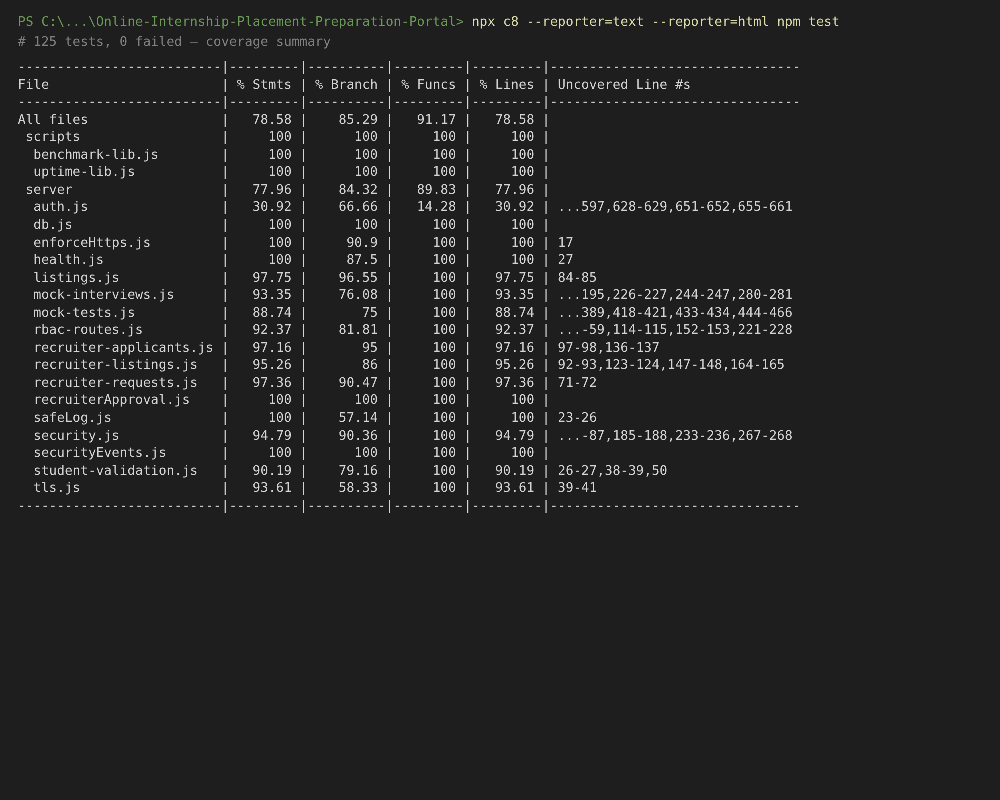
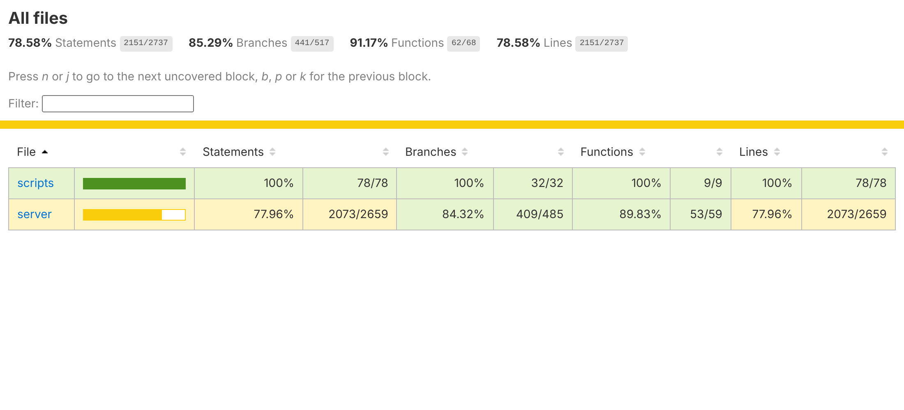
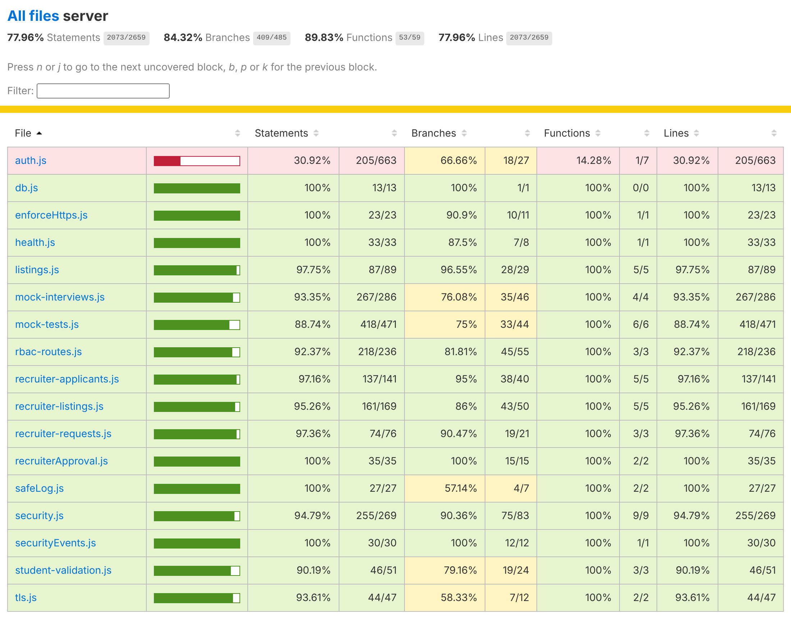
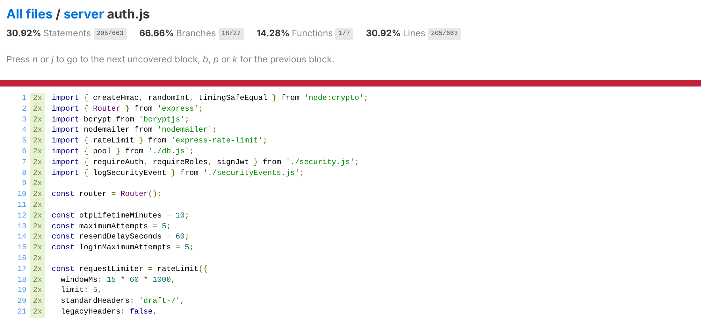
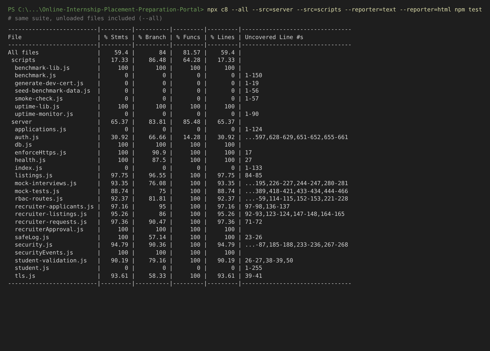

# Code Coverage Report

Online Internship & Placement Preparation Portal (OIPP) 

|**What was measured**|The backend code in`server/`and the helper code in`scripts/`, while running the<br>automated tests we already have (`npm test`). No new tests were written for this<br>report.|
|---|---|
|**Tool**|c8, which is already in the project's devDependencies|
|**Code version**|main branch, commit`fd92de5`, 12 Nov 2026|
|**Test result**|125 tests, 125 passed, 0 failed|

## 1. Overall coverage

I ran this from the project root: 

```
npx c8 --reporter=text --reporter=html npm test
```

|**Metric**|**Coverage**|**Covered / total**|
|---|---|---|
|Statements|78.58%|2151 / 2737|
|Branches|85.29%|441 / 517|
|Functions|91.17%|62 / 68|
|Lines|78.58%|2151 / 2737|

Statements and lines match because c8 counts statements per line, so they are not really two independent numbers. 

By default c8 reports the files that the test suite loads. Adding `--all` also includes the remaining source files in `server/` ( `index.js` , `student.js` , `applications.js` ) and `scripts/` : 

```
npx c8 --all --src=server --src=scripts --reporter=text --reporter=html npm test
```

|**Metric**|**Default run**|**With --all**|
|---|---|---|
|Statements|78.58%|59.40% (2151 / 3621)|
|Branches|85.29%|84.00% (441 / 525)|
|Functions|91.17%|81.57% (62 / 76)|
|Lines|78.58%|59.40% (2151 / 3621)|

The default run reports the code exercised by the test suite, and the `--all` run widens the measurement to every source file. 

## 2. Coverage by file

|**File**|**Statements**|**Branches**|**Functions**|**Lines**|
|---|---|---|---|---|
|`auth.js`|30.92%|66.66%|14.28%|30.92%|
|`mock-tests.js`|88.74%|75.00%|100%|88.74%|
|`student-validation.js`|90.19%|79.16%|100%|90.19%|
|`rbac-routes.js`|92.37%|81.81%|100%|92.37%|
|`mock-interviews.js`|93.35%|76.08%|100%|93.35%|
|`tls.js`|93.61%|58.33%|100%|93.61%|
|`security.js`|94.79%|90.36%|100%|94.79%|
|`recruiter-listings.js`|95.26%|86.00%|100%|95.26%|
|`recruiter-applicants.js`|97.16%|95.00%|100%|97.16%|
|`recruiter-requests.js`|97.36%|90.47%|100%|97.36%|
|`listings.js`|97.75%|96.55%|100%|97.75%|
|`enforceHttps.js`|100%|90.90%|100%|100%|
|`health.js`|100%|87.50%|100%|100%|
|`safeLog.js`|100%|57.14%|100%|100%|
|`db.js`,`recruiterApproval.js`,`securityEvents.js`|100%|100%|100%|100%|
|`benchmark-lib.js`,`uptime-lib.js`(scripts)|100%|100%|100%|100%|

Files only included in the `--all` run: `server/index.js` , `server/student.js` , `server/applications.js` , and the scripts `benchmark.js` , `generate-dev-cert.js` , `seed-benchmark-data.js` , `smoke-check.js` and `uptimemonitor.js` . 

## 3. Lower-coverage areas and uncovered lines

**auth.js** has the lowest coverage at 30.92% statements. The lines the tests do not reach are mostly the student registration and login routes: 

|**Uncovered lines**|**What they are**|
|---|---|
|42-96|Helper functions: institutional email check, OTP digest, mailer setup, registration<br>validation|
|100-214|Student registration, request OTP route|
|219-352|Student registration, verify OTP route|
|357-487|Student login route, including lockout|
|499-502, 559-566|Recruiter login failure and lockout branches|
|594-597, 628-629|Admin login failure branches|
|651-661|Error path in`/me`and the`lockoutDurationMinutes()`function|

**Other files.** The remaining uncovered lines are mostly error-handling paths, for example the `catch` blocks that call `next(error)` when a database call fails. 

|**File**|**Uncovered lines**|**Branches not fully covered**<br>**(line numbers)**|
|---|---|---|
|`mock-tests.js`|195-198, 216-217, 279-280, 294-297, 304-307, 328-<br>331, 386-389, 418-421, 433-434, 444-466|124, 194, 215, 275, 278, 293,<br>303, 327, 385, 417, 432|
|`mock-interviews.js`|44-45, 104-105, 113-114, 146-147, 193-195, 226-<br>227, 244-247, 280-281|9, 43, 103, 113, 115, 145, 193,<br>225, 241, 243, 279|
|`rbac-routes.js`|28-29, 56-59, 114-115, 152-153, 221-228|19, 27, 55, 97-100, 113, 151,<br>166, 220|
|`security.js`|51-52, 86-87, 185-188, 233-236, 267-268|6, 50, 61, 85, 168, 184, 232,<br>266|
|`student-`<br>`validation.js`|26-27, 38-39, 50|25, 37, 44, 46, 50|
|`recruiter-`<br>`listings.js`|92-93, 123-124, 147-148, 164-165|28, 91, 110, 122, 131, 146, 163|
|`recruiter-`<br>`applicants.js`|97-98, 136-137|96, 135|
|`recruiter-`<br>`requests.js`|71-72|38, 71|
|`tls.js`|39-41 (invalid Host header returns 400)|16, 18, 36, 38, 43|
|`safeLog.js`|none|23, 24, 26 (fallbacks in<br>`logError`)|
|`listings.js`|84-85 (database error path)|83|
|`enforceHttps.js`,<br>`health.js`|none|17, 27|

## 4. Evidence

Terminal summary from the default run: 

Output of `npx c8 --reporter=text --reporter=html npm test` . The coverage table is c8's text report. 



HTML report, main page ( `coverage/index.html` ): 

Overall totals for statements, branches, functions and lines. 



HTML report, `server/` folder ( `coverage/server/index.html` ): 

Coverage for each file in `server/` . 



HTML report for `auth.js` , where the red highlighting marks lines not executed during the tests: 

Top of `server/auth.js` in the HTML report. 



Terminal summary from the `--all` run: 

Output of the `--all` command from section 1. 



## 5. Environment

|**Test runner**|Node's built-in runner (`node --test`, run through`npm test`)|
|---|---|
|**Coverage tool**|c8 ^12.0.0 (V8 coverage), text and html reporters|
|**Runtime**|Node.js v22.23.4, npm 10.9.9, Linux, dependencies installed fresh with`npm ci`|
|**Output**|Table in the terminal and an HTML report in`coverage/`|

## 6. Scope notes

- The measurement covers the backend ( `server/` and `scripts/` ). The React front end in `src/` is validated through the UI evidence in the Combined Testing Report. 

- Several route tests use a mocked or isolated database, so the figures describe the application code rather than live SQL execution. 

- Statement and line coverage are equal because c8 counts statements per line. 

- Coverage shows which code ran during the tests; it is one measure alongside the functional and nonfunctional results in the Combined Testing Report.
